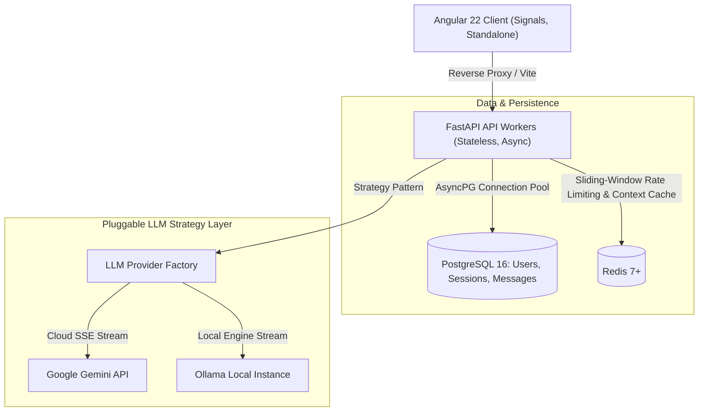

# AGENT.md — Engineering Guide & Operational Manual for AI Agents

> **Audience**: AI Coding Agents (and engineers pair-programming with AI) working in this repository.  
> **Repository**: Enterprise Scalable AI Agent Monorepo  
> **Key Tech Stack**: FastAPI (Python 3.10+), SQLAlchemy 2.0 (`asyncpg`), PostgreSQL 16, Redis 7, Angular 22 (Standalone + Signals), Vitest, Pytest, Astral Ruff, Astral ty.

---

## 1. System Overview & Core Philosophy

This repository is a decoupled, enterprise-grade, high-concurrency AI Agent platform designed for multi-tenant real-time streaming conversations with Human-in-the-Loop (HITL) tool calling.



### Critical Architectural Invariants (Do NOT Violate)

1. **Two-Phase Decoupled Database Transaction Pattern**:
   - LLM inference takes 5–30 seconds. **NEVER** hold an open database connection or active transaction across an LLM streaming call or tool execution.
   - **Phase 1**: Check out connection, load context / user prompt, release connection immediately back to the `asyncpg` pool.
   - **Streaming**: Stream tokens / tool calls from LLM without any database connection.
   - **Phase 2**: Check out a fresh connection from the pool, persist the completed assistant message / tool state in an isolated short transaction, and immediately commit.
2. **Multi-Tenant Row-Level Security**:
   - Every database query for sessions, messages, or tools **must strictly filter** by `(id == session_id, user_id == current_user.id)`. Never expose cross-tenant data.
3. **Human-in-the-Loop (HITL) Tool Approval**:
   - In the web application, tool calls requested by an LLM are saved with status `awaiting_approval`.
   - Execution is halted until the authenticated user explicitly submits an approval request via `/api/v1/chats/{session_id}/tools/approve`.
   - Never execute external/system tools autonomously without checking approval requirements.
4. **Fail-Open Resilience**:
   - Redis is used for rate-limiting (ZSET sliding window) and turn caching. If Redis is unavailable or fails, operations must fail-open (log warning and fall back to PostgreSQL or allow the request) without breaking the user experience.
5. **Modern Reactive Frontend (Angular Signals & Standalone)**:
   - Frontend is built exclusively with Angular 22 standalone components and Signals (`signal()`, `computed()`, `effect()`).
   - Do **NOT** introduce legacy `NgModule` modules or unneeded RxJS subscription chains. SSE streaming consumes native `ReadableStreamDefaultReader`.

---

## 2. Monorepo Directory Map

```text
simple-ai-agent/
├── AGENT.md                         # This file: instructions & operational manual for AI agents
├── README.md                        # Project overview and quickstart
├── Makefile                         # Unified command runner for dev, test, lint, format
├── docker-compose.yml               # Local infrastructure (Postgres 16, Redis 7, Ollama)
├── dev.sh / dev                     # Dual-service concurrent runner (API + Web)
├── .env.example / .env              # Environment variable configurations
├── docs/
│   └── ARCHITECTURE_AND_CODE_WALKTHROUGH.md # Deep dive into system internals & design rationale
├── scripts/
│   ├── verify_infra.py              # Infra connectivity & environment sanity checks
│   └── benchmark_concurrency.py     # High-concurrency load testing & latency percentiles
├── apps/
│   ├── api/                         # FastAPI Asynchronous Backend
│   │   ├── alembic/                 # Alembic DB migration revisions & env
│   │   ├── app/
│   │   │   ├── main.py              # FastAPI app creation, lifespan, CORS, /health
│   │   │   ├── core/                # Config, security (Argon2id, JWT), dependencies, Redis pool, rate limiter
│   │   │   ├── db/                  # AsyncPG engine, sessionmaker, get_db, get_session_factory
│   │   │   ├── models/              # SQLAlchemy 2.0 ORM models (User, ChatSession, ChatMessage)
│   │   │   ├── schemas/             # Pydantic v2 schemas (Auth, Chat, LLM, Tools)
│   │   │   ├── routes/              # FastAPI route endpoints (/auth, /chats)
│   │   │   ├── controllers/         # Request handling & orchestration controllers
│   │   │   ├── services/            # ChatService, ChatStreamService, ChatCacheService, MemoryManager, AuthService
│   │   │   ├── providers/           # Pluggable LLM strategy layer (Gemini, Ollama, Base, Factory)
│   │   │   ├── tools/               # Dynamic tool introspection, calculator, search (Tavily), registry
│   │   │   └── tests/               # Pytest test suites (54+ async tests)
│   │   └── pyproject.toml           # Python dependencies, Ruff, ty, Hatchling config
│   └── web/                         # Angular 22 Frontend (Standalone Components + Signals)
│       ├── src/
│       │   ├── main.ts              # Angular bootstrap
│       │   ├── app/
│       │   │   ├── app.config.ts    # Application config (providers, routing, interceptors)
│       │   │   ├── app.routes.ts    # Route definitions (guards: authGuard, guestGuard)
│       │   │   ├── core/            # AuthService, ChatService, guards, interceptors, models
│       │   │   ├── features/        # Feature components (auth/login, auth/register, chat/layout, sidebar, window)
│       │   │   └── shared/          # Shared pipes (safe MarkdownPipe), UI utilities
│       │   └── styles.scss          # Terminal & dark mode styling tokens
│       ├── proxy.conf.json          # Reverse proxy mapping /api to http://localhost:8000
│       └── package.json             # Angular 22, Vitest, TypeScript dependencies
├── shared/                          # Cross-cutting contracts
│   ├── openapi.json                 # OpenAPI 3.1.0 specification
│   └── types/
│       └── api.ts                   # TypeScript interfaces matching backend contracts & SSE events
└── graft/                           # Code graph index and symbol cards for repo mapping
```

---

## 3. Key Components & File Walkthrough

### 3.1. Backend (`apps/api`)

| Path | Purpose | Key Conventions |
| :--- | :--- | :--- |
| `app/core/config.py` | Environment configuration via Pydantic Settings | Read from `.env`, defaults provided for local dev. |
| `app/core/security.py` | Argon2id hashing & JWT token handling | Uses `pwdlib[argon2]` & `pyjwt`. Non-blocking. |
| `app/core/redis.py` | Asynchronous Redis connection singleton | `get_redis_client()` with fail-open wrappers. |
| `app/core/rate_limiter.py` | ZSET sliding-window distributed rate limiter | Keyed by `(scope, user_id or ip)`. Returns `429` with `Retry-After`. |
| `app/db/session.py` | Async SQLAlchemy engine & session factories | Pool sizing: `pool_size=20, max_overflow=10`. Use `get_db` for request scope, `get_session_factory` for decoupled streams. |
| `app/models/` | SQLAlchemy 2.0 ORM models | Mapped via `Mapped[T]` and `mapped_column()`. Foreign keys enforce `CASCADE`. |
| `app/schemas/` | Pydantic v2 schemas | Request/response DTOs with `from_attributes = True`. |
| `app/providers/` | Pluggable LLM strategies | Subclass `BaseLLMProvider`. Use `LLMProviderFactory.get_provider(name)`. |
| `app/tools/base.py` | Dynamic tool introspection | `function_to_tool_definition(func)` dynamically generates OpenAPI schemas from Python docstrings and type hints. |
| `app/tools/calculator.py` | Tool registry & arithmetic tool | `AVAILABLE_TOOLS` dictionary maps tool names to callable Python functions. |
| `app/tools/search.py` | Web search tool | Powered by Tavily API client (`search_web`). |
| `app/services/memory_manager.py` | Sliding-window context pruner | Truncates older turns to keep context under token thresholds. |
| `app/services/chat_cache_service.py` | Redis turn caching | Stores recent conversation context with 1h TTL; avoids Postgres read load. |
| `app/services/chat_stream_service.py` | Streaming coordinator | Executes 2-phase decoupled transactions, SSE framing, and autonomous tool loops. |

### 3.2. Frontend (`apps/web`)

| Path | Purpose | Key Conventions |
| :--- | :--- | :--- |
| `src/app/core/services/auth.service.ts` | Reactive auth state | Uses `signal<User | null>` and `computed(() => !!user())`. Manages JWT in `localStorage`. |
| `src/app/core/services/chat.service.ts` | Chat sessions & streaming | Signal-driven store. SSE consumer using `ReadableStreamDefaultReader` with boundary buffering. |
| `src/app/core/guards/` | Route access control | Functional guards: `authGuard` and `guestGuard`. |
| `src/app/core/interceptors/auth.interceptor.ts` | Functional HTTP interceptor | Injects `Authorization: Bearer <token>` into outbound requests. |
| `src/app/features/chat/chat-window/` | Main conversation UI | Renders message lists, live streaming tokens, and interactive HITL Tool Approval Cards. |
| `src/app/features/chat/chat-sidebar/` | Session management | Lists sessions, supports active thread switching, "+ New Chat", and deletion. |
| `src/app/shared/pipes/markdown.pipe.ts` | Markdown parsing | Sanitizes input, formats code fences, and renders syntax blocks safely without XSS. |

### 3.3. Shared Contracts (`shared/`)

- `shared/openapi.json`: Authoritative OpenAPI 3.1.0 specification generated from FastAPI.
- `shared/types/api.ts`: TypeScript contracts for API entities (`ChatSessionResponse`, `ChatMessageResponse`, `ToolCall`, `ToolApprovalRequest`) and SSE streaming events:
  - `chunk`: Real-time token streaming (`SseChunkEvent`).
  - `tool_call`: Tool invocation request (`SseToolCallEvent`).
  - `tool_result`: Tool execution output (`SseToolResultEvent`).
  - `done`: Stream completion and final status (`SseDoneEvent`).
  - `error`: Error payload (`SseErrorEvent`).

---

## 4. Development & Operational Commands

All standard workflows are controlled via the root [`Makefile`](Makefile):

### Infrastructure
```bash
make up          # Start Postgres 16, Redis 7, Ollama containers
make down        # Stop local containers
make logs        # Tail Docker logs
make verify      # Verify monorepo layout and service port connectivity
```

### Backend (Python / FastAPI)
```bash
make dev-api        # Start FastAPI backend (http://localhost:8000)
make test-api       # Run full Pytest suite (apps/api/app/tests)
make lint-api       # Check linting and formatting with Ruff
make format-api     # Auto-format and autofix code with Ruff
make typecheck-api  # Run strict static type checking with Astral ty
make lint           # Alias for lint-api + typecheck-api
make format         # Alias for format-api
make migrate        # Apply Alembic database migrations
```

### Frontend (Angular 22 / Vitest)
```bash
make dev-web     # Start Angular dev server with proxy to API (http://localhost:4200)
make test-web    # Run frontend unit tests using Vitest (non-watching)
make build-web   # Create production build in apps/web/dist
```

### Monorepo Full Verification
```bash
make test-all    # Runs both backend (test-api) and frontend (test-web) suites
make benchmark   # High-concurrency load testing & percentile benchmark
```

---

## 5. Coding Standards & Conventions

### 5.1. Backend (Python 3.10+)

1. **Type Annotations**:
   - Use Python 3.10+ native union syntax (`str | None`, `int | float`), `list[str]`, `dict[str, Any]`.
   - Never use legacy `typing.Optional` or `typing.List` in new code.
   - Code must pass `make typecheck-api` (`ty check`) without errors.
2. **Database Queries**:
   - Always use SQLAlchemy 2.0 select syntax: `stmt = select(Model).where(...)`.
   - Never use legacy query syntax (`session.query(Model)`).
   - Commit transactions explicitly and cleanly; keep transactions minimal in duration.
3. **Pydantic Validation**:
   - Use Pydantic v2 schemas for all request/response models.
   - Configure `model_config = ConfigDict(from_attributes=True)` on response schemas.
4. **Code Quality**:
   - Formatting and linting are strictly governed by Astral Ruff (`line-length = 88`).
   - Run `make format-api` and `make lint-api` before concluding work.

### 5.2. Frontend (Angular 22 & TypeScript)

1. **Signals-First Reactive State**:
   - Manage component and service state using `signal()`, `computed()`, and `effect()`.
   - Do not create RxJS Subjects or manual `.subscribe()` calls when a Signal cleanly handles the state.
2. **Standalone Architecture**:
   - All components, directives, and pipes must be standalone (`standalone: true` or Angular 22 default).
   - Use functional routing guards (`CanActivateFn`) and functional interceptors (`HttpInterceptorFn`).
3. **Typing & Contracts**:
   - Keep models in sync with `shared/types/api.ts`.
   - Strict TypeScript configuration; avoid `any` wherever possible.
4. **Testing**:
   - Write unit tests using Vitest in `.spec.ts` files.
   - Mock HTTP requests using `HttpTestingController` or mocked service signals.

---

## 6. Agent Modification Playbooks

### Playbook A: Adding a New Agent Tool

1. **Write the Tool Function** in `apps/api/app/tools/`:
   ```python
   # apps/api/app/tools/weather.py
   def get_current_weather(location: str, unit: str = "celsius") -> dict[str, Any]:
       """Get the current weather for a given city location."""
       # Implementation
       return {"location": location, "temperature": 22, "unit": unit}
   ```
2. **Register the Tool** in `apps/api/app/tools/calculator.py` (or central registry):
   ```python
   AVAILABLE_TOOLS["get_current_weather"] = get_current_weather
   ```
   *Note: `TOOL_DEFINITIONS` automatically regenerates OpenAI schemas using `function_to_tool_definition`!*
3. **Add Tests** in `apps/api/app/tests/test_calculator_tools.py` verifying both execution and dynamic schema generation.
4. **Update Frontend Models/Views** if custom UI rendering or confirmation parameters are needed.

### Playbook B: Adding a New LLM Provider

1. **Create Adapter** in `apps/api/app/providers/`:
   - Inherit from `BaseLLMProvider` (`apps/api/app/providers/base.py`).
   - Implement `stream_chat(self, messages, tools=None) -> AsyncIterator[LLMStreamChunk]`.
2. **Register in Factory** in `apps/api/app/providers/factory.py`:
   - Add provider identifier to `LLMProviderFactory.get_provider()`.
3. **Add Provider Tests** in `apps/api/app/tests/test_llm_providers.py`.

### Playbook C: Adding a New Database Entity

1. **Define ORM Model** in `apps/api/app/models/`:
   - Inherit from `Base` (`apps/api/app/models/base.py`).
   - Include UUID primary keys, tenant `user_id` foreign key, and `created_at` timestamp.
2. **Expose Model** in `apps/api/app/models/__init__.py`.
3. **Generate & Run Migration**:
   ```bash
   cd apps/api && .venv/bin/alembic revision --autogenerate -m "add new model"
   make migrate
   ```
4. **Create Pydantic Schemas** in `apps/api/app/schemas/`.
5. **Add Repository/Service Methods** enforcing `user_id` multi-tenant boundaries.

---

## 7. Quality Gate Checklist for AI Agents

Before submitting changes, completing tasks, or committing code, every AI agent must execute this verification checklist:

- [ ] **Infrastructure & Environment**:
  - Run `make verify` or ensure expected services/ports are accessible.
- [ ] **Backend Quality**:
  - Format & Lint: `make format-api && make lint-api` (must exit 0 with no warnings).
  - Typecheck: `make typecheck-api` (must report zero errors).
  - Tests: `make test-api` (all 54+ tests must pass).
- [ ] **Frontend Quality**:
  - Tests: `make test-web` (all Vitest suites must pass).
  - Build: `make build-web` (production Angular build must compile without bundle errors).
- [ ] **Full Monorepo Gate**:
  - Run `make test-all`.
- [ ] **Security & Multi-Tenancy**:
  - Verify every query on user data checks `user_id == current_user.id`.
  - Confirm no database transactions are held open across streaming/network I/O loops.
