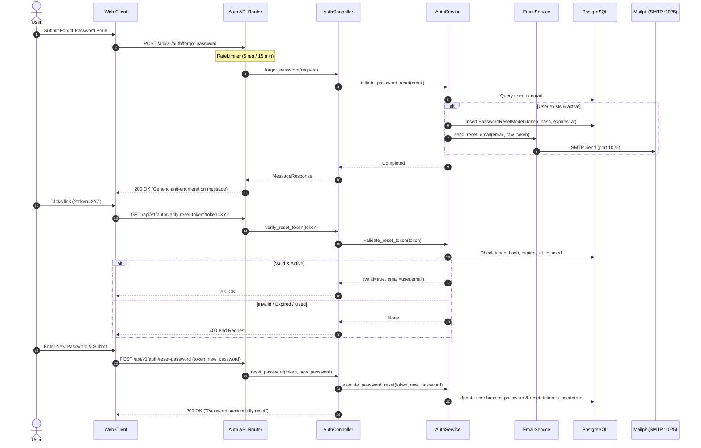

# Technical Architecture & Implementation Plan: Password Reset API

## 1. System Architecture

---

## 2. Affected Files & Schemas

### Infrastructure & Config
- `docker-compose.yml`: Adds `mailpit` container service (`axllent/mailpit:latest` on ports 1025 and 8025).
- `.env.example` / `.env`: Sets `SMTP_HOST=localhost`, `SMTP_PORT=1025`, `SMTP_FROM_EMAIL=noreply@example.com`, `SMTP_USE_TLS=false`, `PASSWORD_RESET_TOKEN_EXPIRE_MINUTES=15`.
- `apps/api/app/core/config.py`: Adds SMTP and reset token configuration attributes to Pydantic `Settings`.

### Database & Models
- `apps/api/app/models/password_reset.py`: Defines `PasswordResetModel` inheriting `Base` and `TimestampMixin`.
- `apps/api/app/models/user.py`: Adds `password_resets` one-to-many relationship with cascade delete.
- `apps/api/app/models/__init__.py`: Exports `PasswordResetModel`.
- `apps/api/alembic/versions/*_create_password_resets_table.py`: Database migration.

### Services & Schemas
- `apps/api/app/services/email_service.py`: `EmailService` utilizing `smtplib.SMTP` in `asyncio.to_thread` for asynchronous email dispatch.
- `apps/api/app/schemas/user.py`: Pydantic models `ForgotPasswordRequest`, `ResetPasswordRequest`, `VerifyResetTokenResponse`, `MessageResponse`.
- `apps/api/app/services/auth_service.py`: Methods for generating, hashing, storing, verifying tokens, and updating user passwords.
- `apps/api/app/controllers/auth_controller.py`: Controller methods coordinating service calls and HTTP exceptions.
- `apps/api/app/routes/auth_routes.py`: Exposing endpoints with rate limiting.

### Tests
- `apps/api/app/tests/test_password_reset.py`: Unit and end-to-end integration tests for all 3 endpoints, edge cases, expiration, and rate limiting.

---

## 3. Dependencies
- Standard library: `hashlib` (SHA-256 for token hashing), `secrets` (cryptographically strong token generation), `smtplib` + `email.message.EmailMessage` (SMTP email building and delivery).
- No new external pip packages required; utilizes existing async framework, Pydantic, SQLAlchemy, and Redis.
