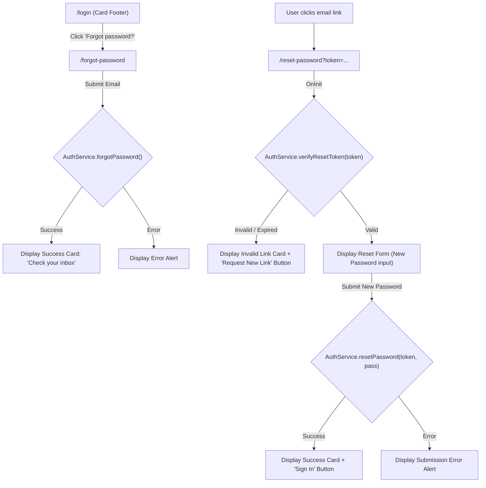

# Technical Architecture & Implementation Plan: Frontend Password Reset

## 1. System Architecture

---

## 2. Affected Files & Schemas

### Models & Services
- `apps/web/src/app/core/models/user.model.ts`: Adds `ForgotPasswordRequest`, `ResetPasswordRequest`, `VerifyResetTokenResponse`, `MessageResponse`.
- `apps/web/src/app/core/services/auth.service.ts`: Adds `forgotPassword`, `verifyResetToken`, `resetPassword`.
- `apps/web/src/app/core/services/auth.service.spec.ts`: Unit tests for newly added methods.

### Components & Routes
- `apps/web/src/app/features/auth/login/login.component.html`: Adds footer link.
- `apps/web/src/app/features/auth/forgot-password/forgot-password.component.ts` & `.html` & `.spec.ts`: Standalone forgot password view.
- `apps/web/src/app/features/auth/reset-password/reset-password.component.ts` & `.html` & `.spec.ts`: Standalone reset password view.
- `apps/web/src/app/app.routes.ts`: Registers routes protected by `guestGuard`.
