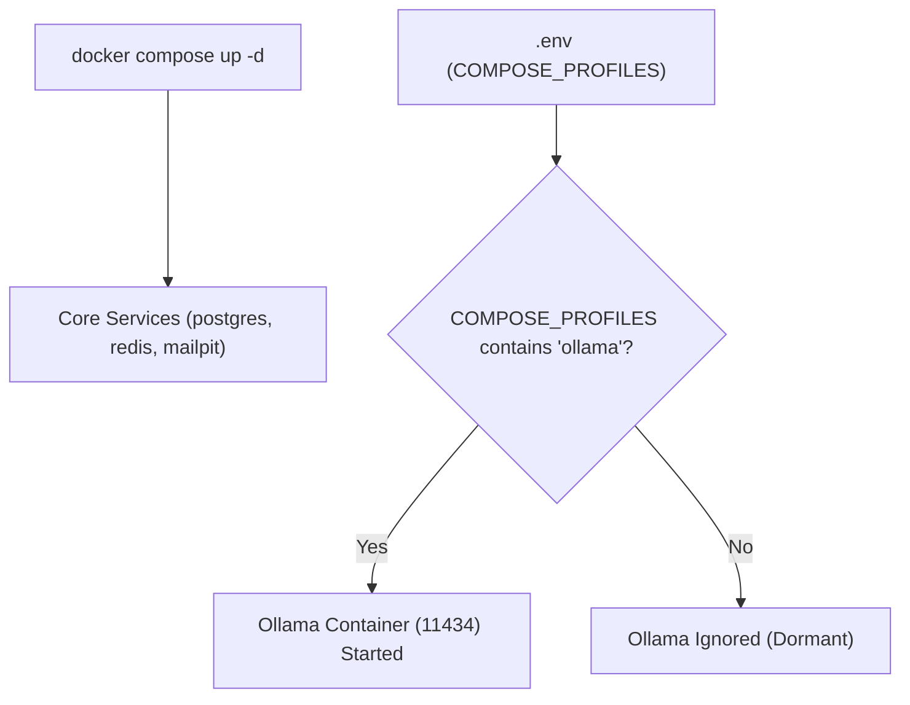

# Technical Plan: Conditional Ollama Container Service

## Architecture & Design
Docker Compose supports the `profiles` top-level attribute for services. Services assigned to one or more profiles do not start during `docker compose up` unless the matching profile is explicitly enabled. Docker Compose automatically respects the `COMPOSE_PROFILES` environment variable when loaded from `.env`.

## Affected Files
- `docker-compose.yml`: Attach `profiles: ["ollama"]` to the `ollama` service.
- `.env.example`: Document `COMPOSE_PROFILES=ollama` (commented out by default).
- `.env`: Document `COMPOSE_PROFILES=ollama` (commented out by default).
- `scripts/verify_infra.py`: Conditionally check port 11434 only if `ollama` profile is active.
- `README.md`: Document usage of `COMPOSE_PROFILES=ollama`.

## Testing Strategy
- Run `docker compose config --services` without profiles to ensure `ollama` is excluded.
- Run `COMPOSE_PROFILES=ollama docker compose config --services` to ensure `ollama` is included.
- Execute `python3 scripts/verify_infra.py` in both modes to verify output behavior.
