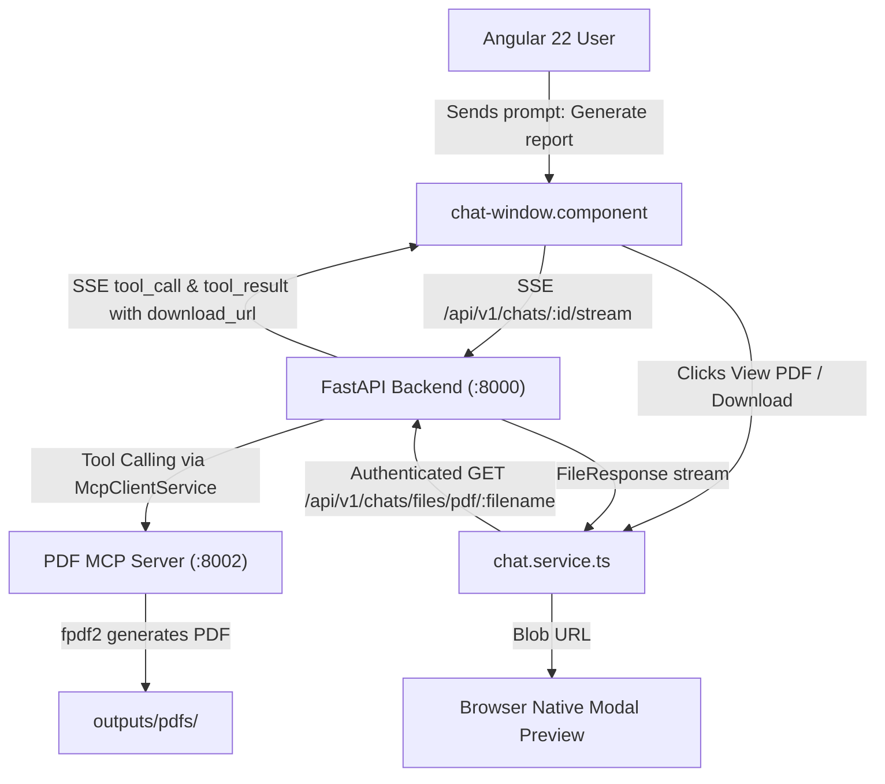

# Feature Plan: End-to-End PDF MCP Server Integration & UI Usage

## 1. Technical Architecture & File Flow

## 2. Affected Files & Changes

### Backend (`apps/api`)
- `apps/api/app/routes/chat_routes.py`:
  - Add `GET /files/pdf/{filename}` with `Depends(get_current_user)`.
  - Validate file existence inside `settings.MCP_PDF_DIR`.
  - Return `FileResponse(path, media_type="application/pdf", filename=safe_filename)`.
- `apps/api/app/mcp_servers/pdf_server.py`:
  - Include `download_url: f"/api/v1/chats/files/pdf/{safe_filename}"` in JSON outputs of `create_pdf` and `merge_pdfs`.
- `apps/api/app/tests/test_pdf_download_api.py`:
  - Test suite covering authentication, file delivery, not-found, and path traversal validation.

### Dev & Infrastructure
- `dev.sh`:
  - Add execution of `app.mcp_servers.pdf_server` on port 8002 in background job group.
- `Makefile`:
  - Add `dev-mcp-pdf` target.

### Frontend (`apps/web`)
- `apps/web/src/app/core/services/chat.service.ts`:
  - Add `getPdfBlob(filename: string): Observable<Blob>`.
- `apps/web/src/app/features/chat/chat-window/chat-window.component.ts`:
  - State signals: `previewPdfUrl: Signal<SafeResourceUrl | null>`, `previewFilename: Signal<string | null>`.
  - Action methods: `openPdfViewer(filename: string)`, `closePdfViewer()`, `downloadPdf(filename: string)`.
- `apps/web/src/app/features/chat/chat-window/chat-window.component.html`:
  - Display `📄` icon for `create_pdf`, `merge_pdfs`, `inspect_pdf`.
  - Display **View PDF** and **Download** action buttons on executed tool cards containing PDF filenames.
  - Minimalist Perplexity-styled modal overlay for previewing PDF in an iframe.
  - Add quick prompt chip: `📄 Generate PDF Report`.
- `apps/web/src/app/features/chat/chat-window/chat-window.component.spec.ts`:
  - Vitest test suite testing PDF tool icon rendering, View PDF action, and Download action.

## 3. Testing Strategy
- Run unit & integration tests on backend: `pytest app/tests/test_pdf_download_api.py app/tests/test_pdf_server.py -v`.
- Check backend code formatting & linting: `ruff check .` & `ty check`.
- Run frontend Vitest test suite: `pnpm --prefix apps/web test --watch=false`.
