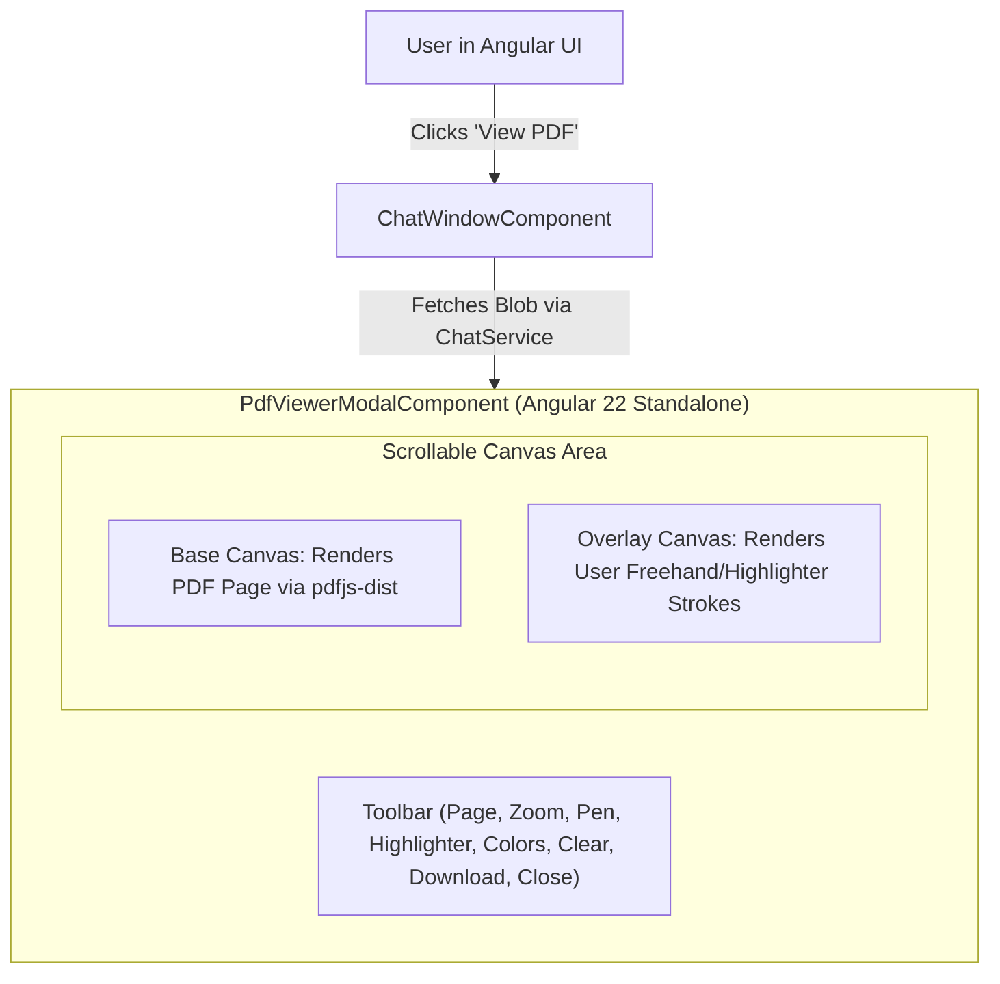

# Feature Plan: Client-Side PDF Canvas Viewer & Annotation Toolbar

## 1. Technical Architecture & File Flow

## 2. Affected Files & Changes

### Dependencies (`apps/web`)
- `apps/web/package.json`: Add `pdfjs-dist` dependency.

### Standalone PDF Viewer Component (`apps/web/src/app/features/chat/pdf-viewer-modal/`)
- `[NEW] pdf-viewer-modal.component.ts`:
  - Standalone component using signals.
  - Page navigation state (`currentPage`, `totalPages`).
  - Zoom state (`zoomScale`, `zoomIn`, `zoomOut`, `fitWidth`, `resetZoom`).
  - Annotation state (`activeTool`, `activeColor`, `strokeWidth`, `clearAnnotations`).
  - Dual canvas handling: `basePdfCanvas` (PDF.js render) and `overlayDrawCanvas` (pointer event stroke recorder).
- `[NEW] pdf-viewer-modal.component.html`:
  - Minimalist Perplexity-styled floating header toolbar with buttons for navigation, zoom, pen, highlighter, colors, clear, download, and close.
  - Responsive canvas container with stacked canvases.
  - Loading spinner overlay while PDF renders.
- `[NEW] pdf-viewer-modal.component.scss`:
  - Overlay positioning, canvas styling, and touch action optimization (`touch-action: none` during draw mode).
- `[NEW] pdf-viewer-modal.component.spec.ts`:
  - Unit tests verifying page controls, zoom changes, tool activation, clear trigger, and close emission.

### Chat Window Integration (`apps/web`)
- `apps/web/src/app/features/chat/chat-window/chat-window.component.ts`:
  - Replace `previewPdfUrl` iframe logic with `activePdfBlob = signal<Blob | null>(null)` and import `PdfViewerModalComponent`.
- `apps/web/src/app/features/chat/chat-window/chat-window.component.html`:
  - Render `<app-pdf-viewer-modal>` instead of the iframe modal.
- `apps/web/src/app/features/chat/chat-window/chat-window.component.spec.ts`:
  - Update unit tests for opening and closing the new viewer modal.

## 3. Testing Strategy
- Vitest suites for `PdfViewerModalComponent` and `ChatWindowComponent`.
- Full Angular production build check (`pnpm build`).
