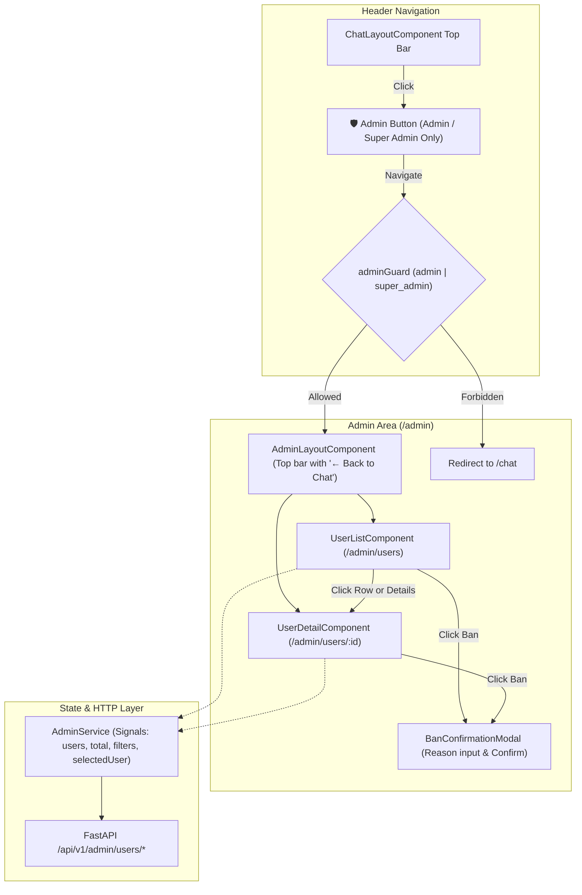

# Technical Architecture & Plan: Frontend Admin User Management Interface

## Architecture Overview
The frontend admin module is designed around Angular 22 standalone components, Angular Signals for reactive state management, and Tailwind CSS for styling matching the existing minimalist palette (`#faf8f5`, `#27251e`, `#016a71`, `#d1d1cd`).

## Affected Files
### Core Layer
- `apps/web/src/app/core/models/admin.model.ts` (New)
- `apps/web/src/app/core/guards/admin.guard.ts` (New)
- `apps/web/src/app/core/guards/admin.guard.spec.ts` (New)
- `apps/web/src/app/core/services/admin.service.ts` (New)
- `apps/web/src/app/core/services/admin.service.spec.ts` (New)

### Features Layer
- `apps/web/src/app/features/admin/admin-layout/admin-layout.component.ts` (New)
- `apps/web/src/app/features/admin/admin-layout/admin-layout.component.html` (New)
- `apps/web/src/app/features/admin/user-list/user-list.component.ts` (New)
- `apps/web/src/app/features/admin/user-list/user-list.component.html` (New)
- `apps/web/src/app/features/admin/user-list/user-list.component.spec.ts` (New)
- `apps/web/src/app/features/admin/user-detail/user-detail.component.ts` (New)
- `apps/web/src/app/features/admin/user-detail/user-detail.component.html` (New)
- `apps/web/src/app/features/admin/user-detail/user-detail.component.spec.ts` (New)

### Routing & Navigation
- `apps/web/src/app/app.routes.ts` (Modified)
- `apps/web/src/app/features/chat/chat-layout/chat-layout.component.ts` (Modified)
- `apps/web/src/app/features/chat/chat-layout/chat-layout.component.html` (Modified)

## Testing Strategy
- Unit tests for `AdminGuard`:
  - Allow access if current user role is `admin` or `super_admin`.
  - Block and redirect to `/chat` if user role is `user`.
  - Fetch profile via `authService.getMe()` if user is not loaded in signal.
- Unit tests for `AdminService`:
  - Test `getUsers`, `getUserDetail`, `banUser`, `unbanUser`, `updateUserRole`.
  - Verify signal updates (`users`, `total`, `isLoading`, `error`).
- Unit tests for `UserListComponent`:
  - Renders user table with correct badges and actions.
  - Opens ban modal and fires ban action with reason.
  - Unban button triggers service call and updates row.
  - Role change dropdown appears only for `super_admin`.
- Unit tests for `UserDetailComponent`:
  - Displays user profile, chat sessions count, and ban state.
  - "Back to Users" navigates to `/admin/users`.
- Integration and build verification:
  - `make test-web` (all suites passing)
  - `make build-web` (production build succeeds with 0 errors)
